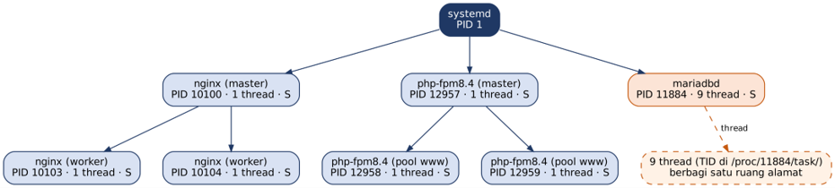

# Diagram Pohon Proses

Diagram ini menggambarkan hubungan proses induk dan proses anak berdasarkan hasil
pengamatan praktikum. PID yang tercantum adalah PID dari sesi pengamatan dan dapat
berubah setelah layanan dimulai ulang.

MariaDB pada sesi pengamatan memiliki 9 thread. Thread-thread tersebut merupakan
aliran eksekusi di dalam proses MariaDB dan berbagi ruang alamat proses.
