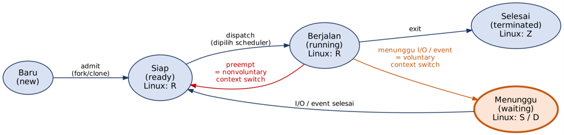

# Diagram Konseptual State Proses

Diagram ini menjelaskan alur state proses yang digunakan dalam dokumentasi praktikum.

Catatan: diagram ini merupakan model konseptual. Label state Linux seperti R, S, D,
dan Z yang terlihat pada sistem merupakan representasi kernel dan tidak identik
satu-banding-satu dengan seluruh state konseptual.
